---
title: マラウイあるある Vol.1-10
date: 2020-03-09 23:00:00
description: 青年海外協力隊としてアフリカのマラウイ (malawi) に滞在中に毎週木曜日に更新していたイラストエッセイ「つぽ絵マラウイあるある」Vol.1〜10。瓶コーラ、レジ事情、電気スイッチ、チェワ語など。
category:
#     - LINEスタンプ
#     - さいとうさん
#     - マラウイ(Malawi)
tags:
    - マラウイ(Malawi)
    - アフリカ(Africa)
    - お絵かき
    - マラウイあるある
cover: "/images/malawi-aruaru/malawi-aruaru-001.png"
cover_index: "/images/malawi-aruaru/malawi-aruaru-001.png"
# cover_detail: "/images/malawi-aruaru/malawi-aruaru-001.png"
sitemap: true
---

毎週木曜日に更新していた「つぽ絵マラウイあるある」シリーズ。

    <article><a href="/images/malawi-aruaru/malawi-aruaru-001.png">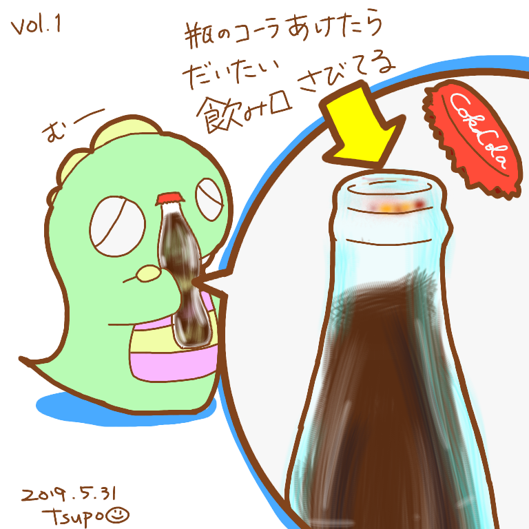</a>
    <h3>Vol.1　瓶コーラ</h3>
    <blockquote>
    瓶のコーラ、スプライト、ファンタが主流。これにマラウイはsoboブランドが加わります。
    ただ、だいたい蓋開けたら錆びてるので注意…。今日のも錆びてました。 （コーラに力入れすぎたけど次からはバケツ塗りにする）
    </blockquote></article>
    <article><a href="/images/malawi-aruaru/malawi-aruaru-002.png">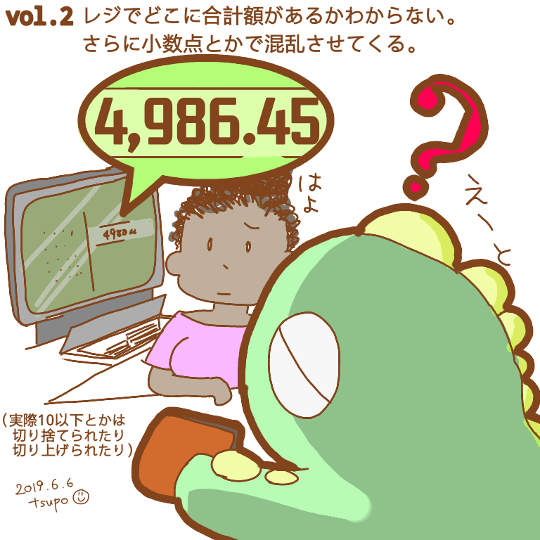</a>
    <h3>Vol.2　レジ</h3>
    <blockquote>
    またいつかマラウイレジ事情で書くけど大手スーパーのレジの合計額はどこかわからない。
見つけてもぱっと読めない。
    小数点いらんやろ。どうせ10K以下はお釣り返ってこないし。
    結局2000K札を適当に何枚か出す。
    これだと6000K払ってお釣りが1020Kか1010K(たまに1015K)
    </blockquote></article>
    <article><a href="/images/malawi-aruaru/malawi-aruaru-003.png">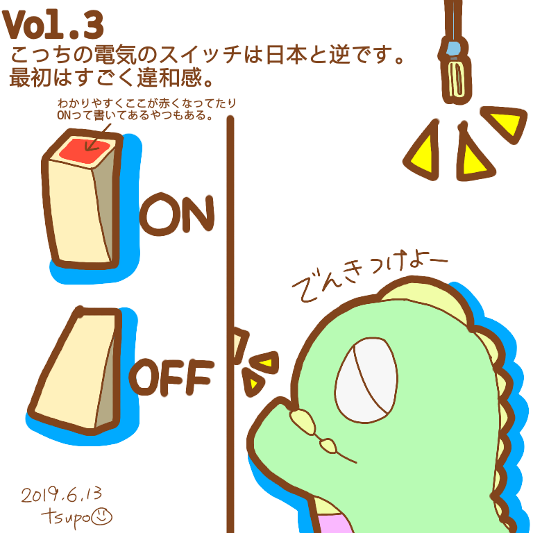</a>
    <h3>Vol.3 電気スイッチが逆</h3>
    <blockquote>
    ライヤー使ってて、スイッチが逆だったのを元に。
    電気のスイッチが逆でなんか気持ち悪い。
    </blockquote></article>
    <article><a href="/images/malawi-aruaru/malawi-aruaru-003-omake.png">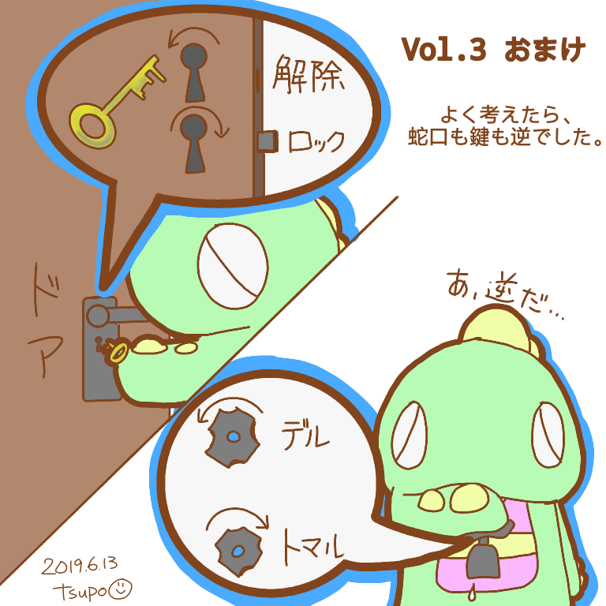</a>
    <h3>Vol.3 おまけ</h3>
    <blockquote>
    おまけ 鍵穴と蛇口も逆だわ
    </blockquote></article>
    <article><a href="/images/malawi-aruaru/malawi-aruaru-004.png">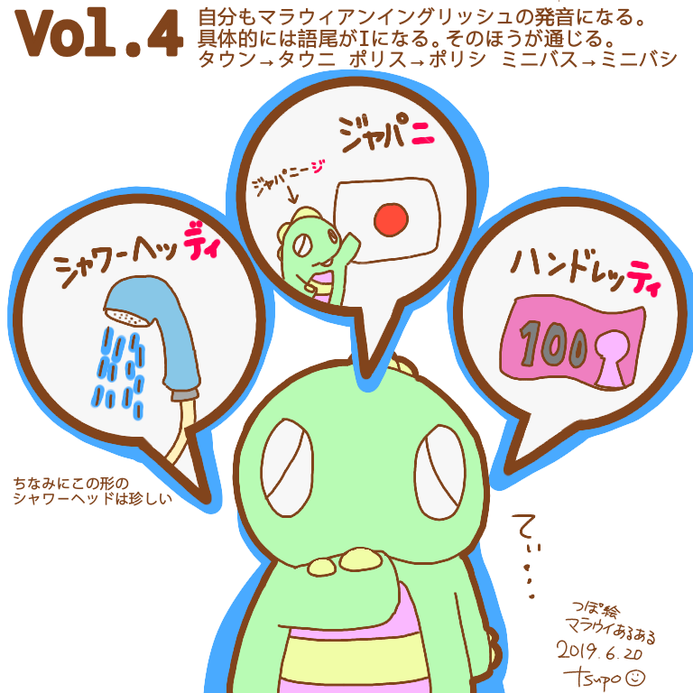</a>
    <h3>Vol.4 チェワ語「最後の『i』」</h3>
    <blockquote>
    日本人が英語をカタカナ発音しちゃう感じで（ポリ「ス」とか、シャワーヘッ「ド」とか）、こっちの人は本当に全部に 『i』 がつきます。 
    もとが何か考えてみよう💡  
    <ul>
        <li>ジューシ
        <li>サウザンディ
    </ul>
    あ、でもチキンはチキンだな…謎。
    </blockquote></article>
    <article><a href="/images/malawi-aruaru/malawi-aruaru-005.png">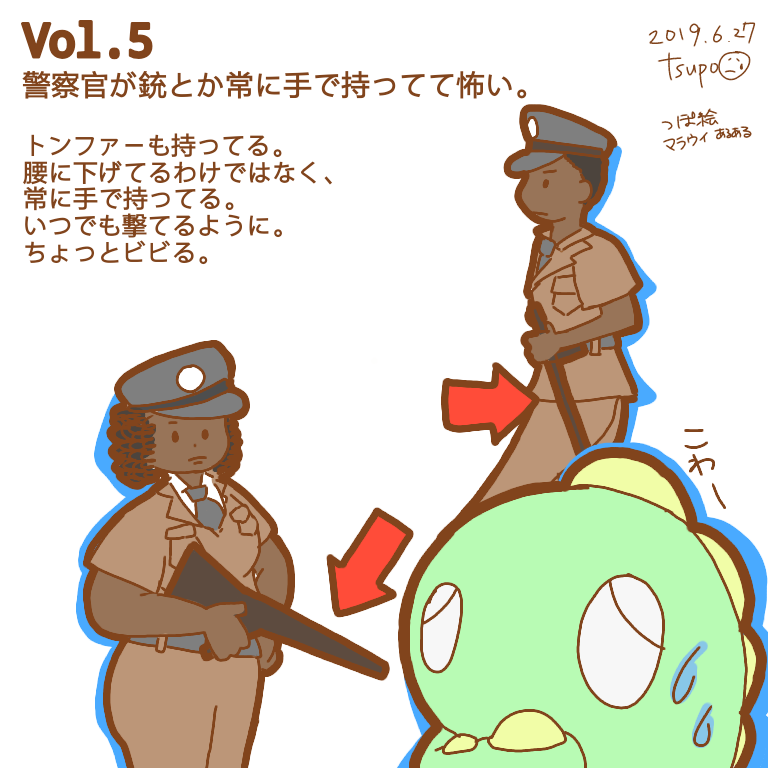</a>
    <h3>Vol.5 警官と銃</h3>
    <blockquote>
    マラウイの警官は銃を手に持ってて怖い、というお話。
    </blockquote></article>
    <article><a href="/images/malawi-aruaru/malawi-aruaru-006.png">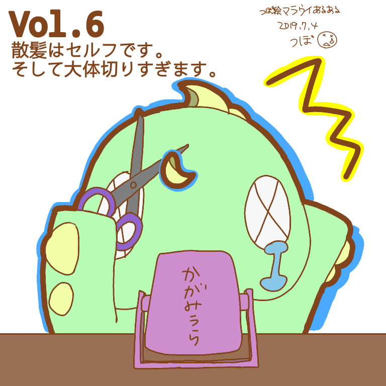</a>
    <h3>Vol.6　セルフ散髪</h3>
    <blockquote>
    そこ髪やったんか！という突っ込みは受け付けていません。
    </blockquote></article>
    <article><a href="/images/malawi-aruaru/malawi-aruaru-007.png">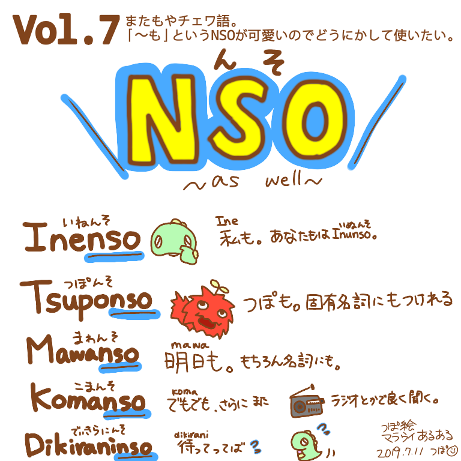</a>
    <h3>Vol.7　チェワ語「んそ」</h3>
    <blockquote>
    あっという間に木曜日が来るんですけど。
    怖い。
    木曜日んそ。
    怖いんそ。
    </blockquote></article>
    <article><a href="/images/malawi-aruaru/malawi-aruaru-008.png">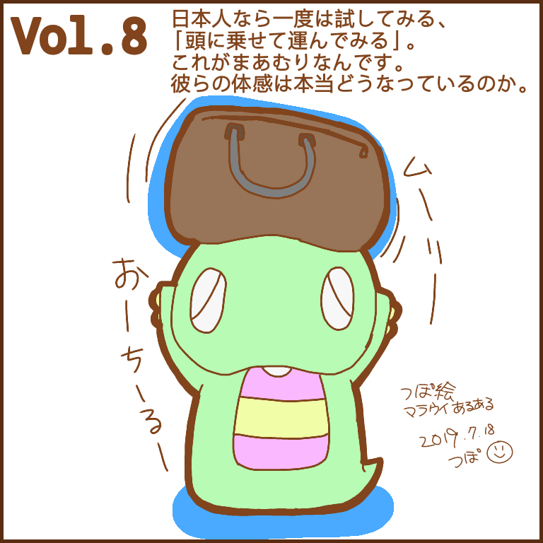</a>
    <h3>Vol.8　頭で運ぶ</h3>
    <blockquote>
    本当何でも頭で運ぶ。
    手がフリーになるからあの技を終幕したいんだけど、まあ無理ですよね(´・ω・`) 誤字見つけた… 
    × 体感 
    ○ 体幹 
    </blockquote></article>
    <article><a href="/images/malawi-aruaru/malawi-aruaru-009.png">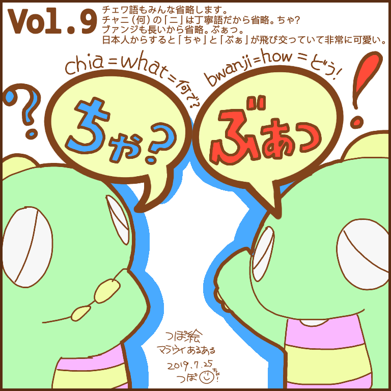</a>
    <h3>Vol.9 チェワ語「『ちゃ』と『ぶぁ』」</h3>
    <blockquote>
    こないだの「んそ」につづき、定期的というか2回に1回チェワ語シリーズ。 
ほんと、かわいいんですよ。語感が。
ちゃ！
    </blockquote></article>
    <article><a href="/images/malawi-aruaru/malawi-aruaru-010.png">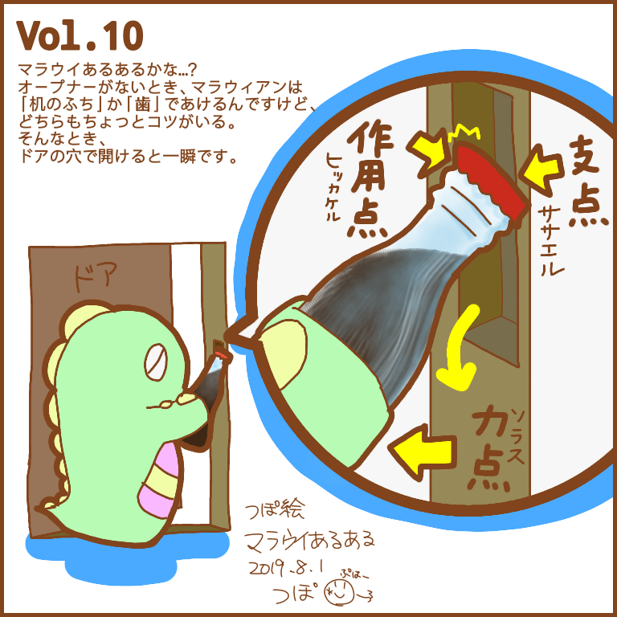</a>
    <h3>Vol.10　瓶コーラのあけかた</h3>
    <blockquote>とうとう2桁に。
    時が経つのが早い。 
    今回は瓶の開け方。
    「栓抜き」という単語が出てこなかったので「オープナー」ていってますが、まあ栓抜きです。 
    コーラ書くとなんか異様に塗りとか凝ってしまっんですけど。
    ほかはバケツ塗りなのに…
    </blockquote></article>

---

### Related Post
- 　&lt;&lt;&lt; 次
- 
- 
- 
- 
