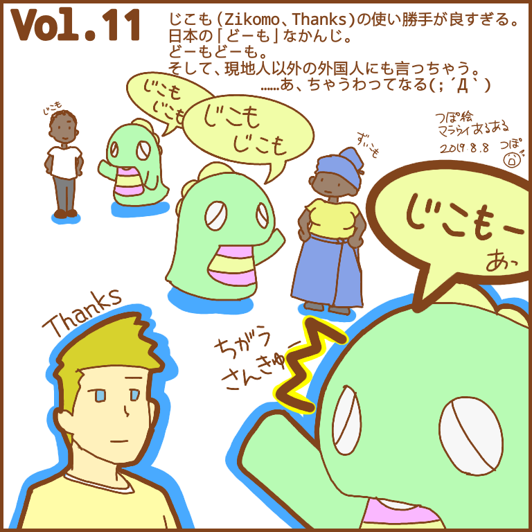
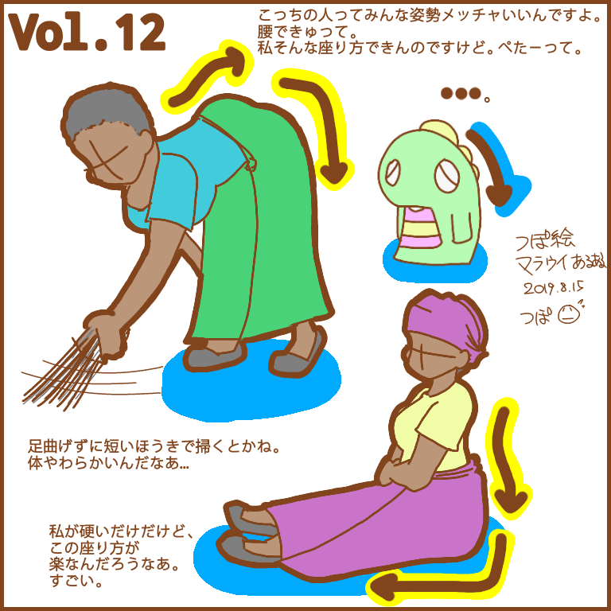
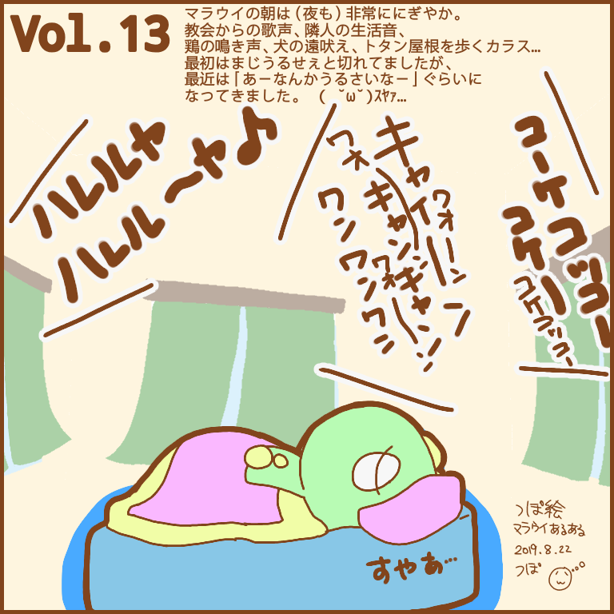
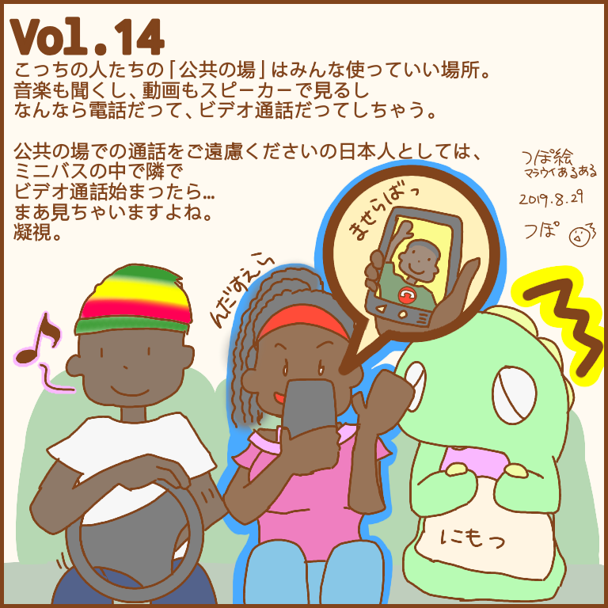
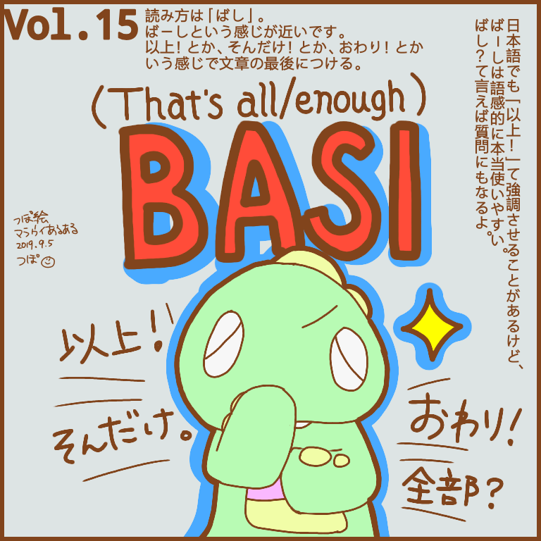
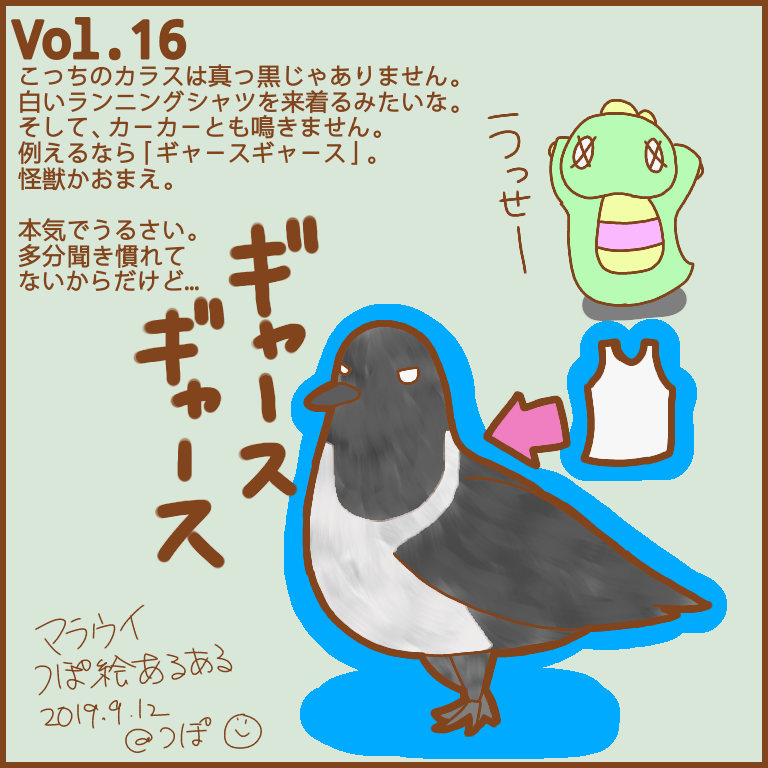
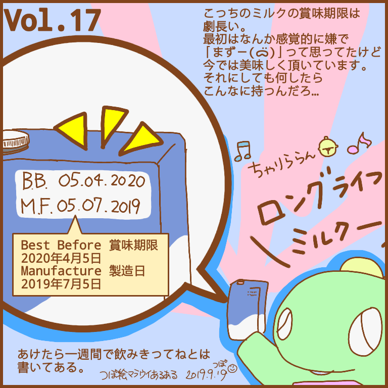
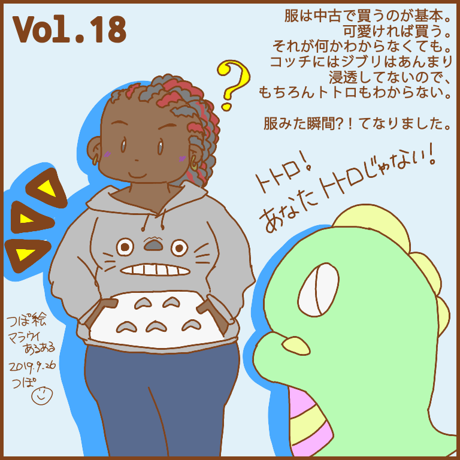
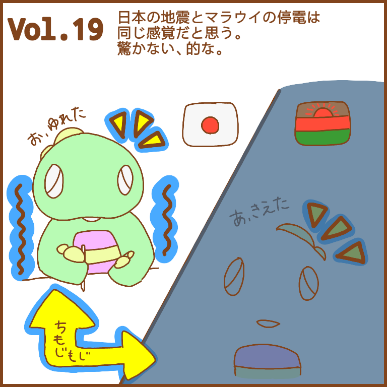
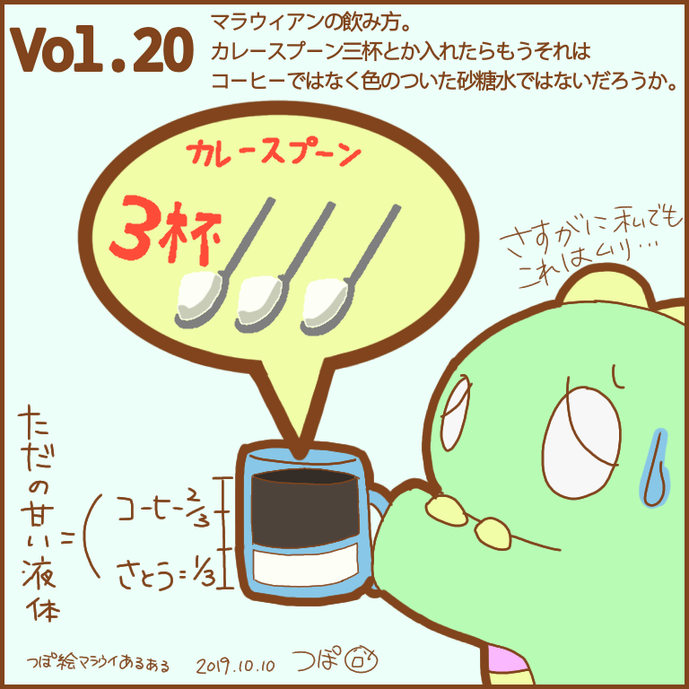

---
title: マラウイあるある Vol.11-20
date: 2020-03-09 23:05:00
description: アフリカのマラウイ (malawi) 生活をイラストで綴る「つぽ絵マラウイあるある」Vol.11〜20。チェワ語「じこも」、骨盤事情、にぎやかな夜、どこでも電話、Basi（ばし）など。
category:
#     - LINEスタンプ
#     - さいとうさん
#     - マラウイ(Malawi)
tags:
    - マラウイ(Malawi)
    - アフリカ(Africa)
    - お絵かき
    - マラウイあるある
cover: "/images/malawi-aruaru/malawi-aruaru-011.png"
cover_index: "/images/malawi-aruaru/malawi-aruaru-011.png"
# cover_detail: "/images/malawi-aruaru/malawi-aruaru-001.png"
sitemap: true
---

毎週木曜日に更新していた「つぽ絵マラウイあるある」シリーズ。その 2。

    <article>
    <h3>Vol.11　チェワ語「じこも」</h3>
    <blockquote>
    毎週木曜日に上げ続けて2桁を超えたのに、「あれどの頻度であげてんの？」と言われ、まだまだだなと思っております。じこもじこも（泣）
    </blockquote></article>
    <article>
    <h3>Vol.12　骨盤</h3>
    <blockquote>
    木曜日はつぽ絵の日。覚えましたか？ 
    お胸もお尻もていうか体全体がボリューミーな人が多いけど、みんなすごくペターンで座っておられる。
    腰でキュッと曲がる。
    足伸ばしたま洗濯掃除とか無理。
    なんであんなに姿勢いいんだろう。
    骨盤…かな…？
    </blockquote></article>
    <article>
    <h3>Vol.13　にぎやかな外</h3>
    <blockquote>
    なんで犬は遠吠えしだすとみんなしちゃいだすんでしょうか。
    ここらへんみんな犬数匹飼ってるから始まるとカオス。 
    なんでカラスはトタン屋根の上歩くんでしょうか。 
    最悪夜中の6時…ん？朝の6時？ぐらいまで隣のレストランは音楽を鳴らすんでしょうか。
    </blockquote></article>
    <article>
    <h3>Vol.14　どこでも電話</h3>
    <blockquote>
    公共の場の認識の違い。
    電話は出るもの。
    多分 Whatsappがきた、と電話が来た、は同じ感じだと思う。  
    なお、電話の挨拶も、むぁせらばっ、んだすぇら、です。 
    あとなんかこの色使いの帽子は人気だと思う。
    </blockquote></article>
    <article>
    <h3>Vol.15　チェワ語「BASI（ばし）」</h3>
    <blockquote>
    隔週でチェワ語の予定だったけどすっかり忘れてたのでここらでチェワ語を。
    みんな大好き Basi. 
    ばーし。 
    マラウィアンも使うけど、それ以上に日本人のほうがこの言葉好きな気がする。
    ばーし。 
     ばし？
    </blockquote></article>
    <article>
    <h3>Vol.16　カラス</h3>
    <blockquote>
    カラスのお話。 
    コッチのはうるさいです。
    そしてトタン屋根の上を歩く。
    鳴き声と足音でうるささ二乗。 
ギャースギャース。
    </blockquote></article>
    <article>
    <h3>Vol.17　ロングライフミルク</h3>
    <blockquote>
    牛乳のお話。 
    賞味期限短いやつもある。袋に入ってたて、200mlとか400mlの。ミニバス乗ってるとパンとともに売ってる。
    でも、例えばカプチーノをカフェで頼んだら使われるのはコッチ。
     
    そして日付けの読み方、やっとで慣れてきたけどやっぱり最初ちゃっと戸惑う…
    </blockquote></article>
    <article>
    <h3>Vol.18　トトロ</h3>
    <blockquote>
    トトロ！あなたトトロっていうのね！ 
って書こうとしたけど、いや知っとるわ。このセリフはむしろこの服着てた人の方だわと思って自重しました。
可愛い服だったなぁ。 
調べたら海外のやつだったので、古着としてこの国に流れてきたんだと思う。
    </blockquote></article>
    <article>
    <h3>Vol.19　自信と停電の奇妙な関係</h3>
    <blockquote>
    停電のお話。 
    Flag of Japan「お、ゆれた」 
    Flag of Malawi「あ、きえた」 
    外国人は最初は騒ぐけど、まあ、慣れるところも。（多分）
    </blockquote></article>
    <article>
    <h3>Vol.20　カレースプーン3杯</h3>
    <blockquote>
    もう20週たっただと…？！(；´Д｀) 
    流石に私はティースプーン半分〜一杯ぐらいです。
    なお、日本のときはミルクのみで砂糖なしでした。
     ティースプーンじゃなくて、カレースプーンですからね。
    味をご想像ください。
    </blockquote></article>

---

### Related Post
- 
- 　&lt;&lt;&lt; 次
- 
- 
- 
