---
title: マラウイあるある Vol.21-30
date: 2020-03-09 23:10:00
description: アフリカのマラウイ (malawi) 生活をイラストで綴る「つぽ絵マラウイあるある」Vol.21〜30。ヒッチハイクの手、肩パッド、日陰の涼しさ、チェワ語「Pepani」、スプーンの持ち方など。
category:
#     - LINEスタンプ
#     - さいとうさん
#     - マラウイ(Malawi)
tags:
    - マラウイ(Malawi)
    - アフリカ(Africa)
    - お絵かき
    - マラウイあるある
cover: "/images/malawi-aruaru/malawi-aruaru-021.png"
cover_index: "/images/malawi-aruaru/malawi-aruaru-021.png"
# cover_detail: "/images/malawi-aruaru/malawi-aruaru-001.png"
sitemap: true
---

毎週木曜日に更新していた「つぽ絵マラウイあるある」シリーズ。その 3。

    <article><a href="/images/malawi-aruaru/malawi-aruaru-021.png">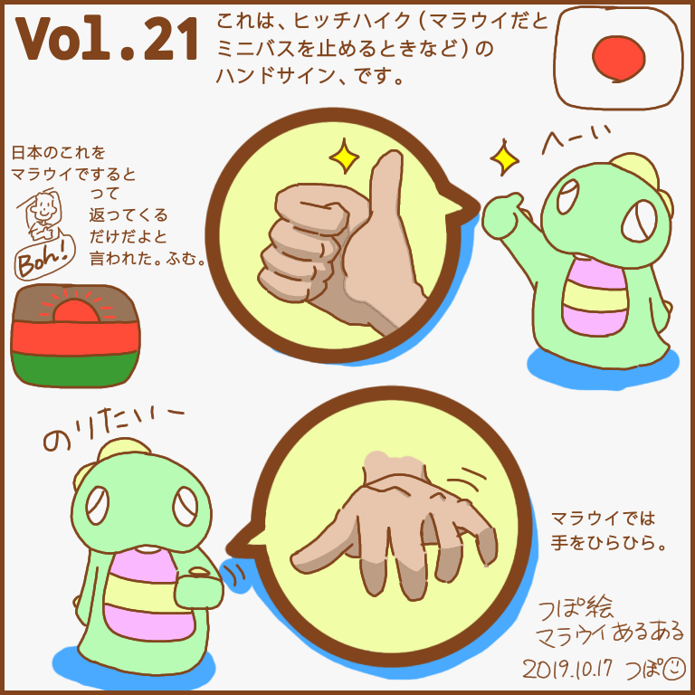</a>
    <h3>Vol.21　ヒッチハイクの手</h3>
    <blockquote>
    ちょっとわかりにくいですが、車を止めたいときのハンドサイン。 
    日本の親指立てたこれはマラウイだと「Boh? (Good?)」っていうお気軽な挨拶なので、止めたい！って言ってこのサインするとミニバスの人は「Boh!」って言いながら通り過ぎてしまうでしょう（泣）
    </blockquote></article>
    <article><a href="/images/malawi-aruaru/malawi-aruaru-022.png">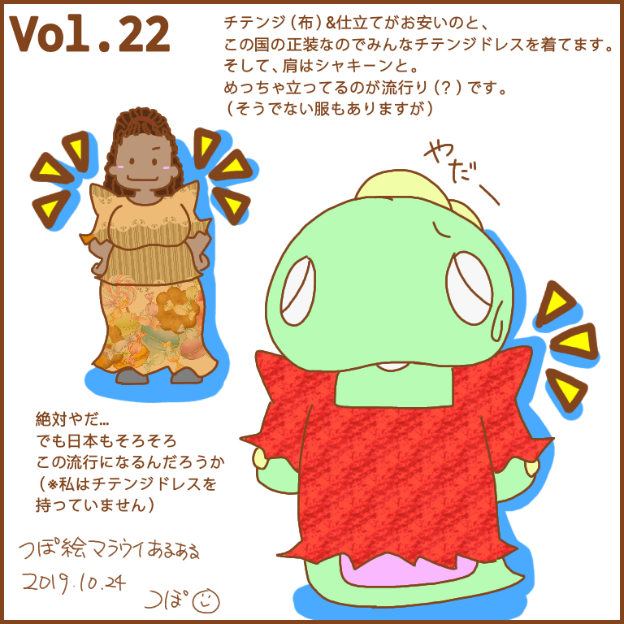</a>
    <h3>Vol.22　肩パッド</h3>
    <blockquote>
    服のお話。 
    マラウイに来た当初からこの肩のいかつさ（？）は気になってた。
    肩パットの比じゃない。
    私はここまでのにはしないぞー（宣言）
    </blockquote></article>
    <article><a href="/images/malawi-aruaru/malawi-aruaru-023.png">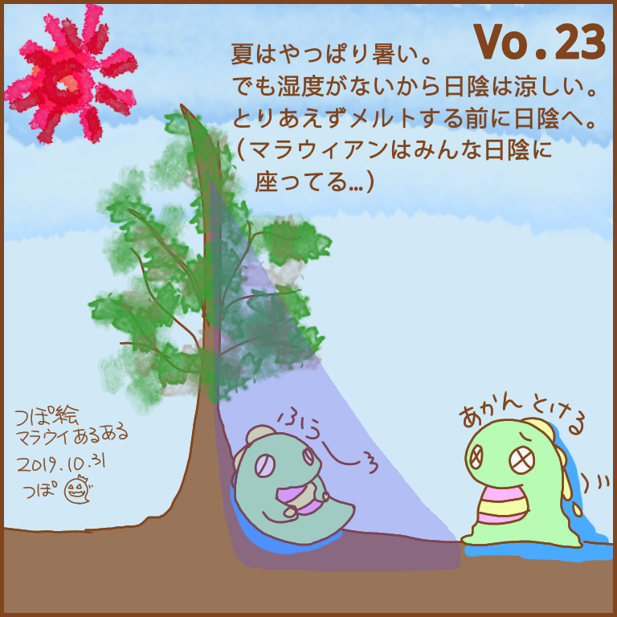</a>
    <h3>Vo.23　日陰</h3>
    <blockquote>
    10月は一番熱い月、らしい。 
    こないだまで布団かぶってねてたのに、暑くて寝れない。
    そして、日中は日向にいたら死んでしまう。
    とりあえず、日陰へ。
    日陰が涼しいのはいいよなあ。日本じゃありえない…
    </blockquote></article>
    <article><a href="/images/malawi-aruaru/malawi-aruaru-024.png">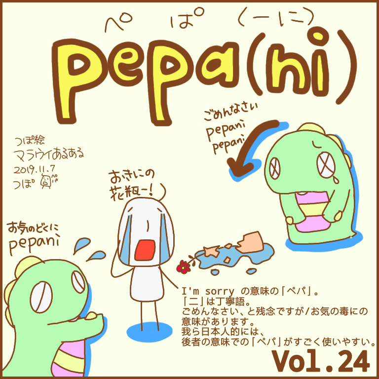</a>
    <h3>Vol.24　チェワ語「Pepani」</h3>
    <blockquote>
    久しぶりのチェワ語です。 
    ペパ。ペパーニ。
    ごめんなさい、てときにも使ってるんだけど、どっちかっていうと、お気の毒に、という意味のほうがよく聞く。 
    体調悪いー　→　ペパーニ 
    仕事多すぎるー　→　ペパーニ 
    パ行って可愛いですよね。使いやすい。
    </blockquote></article>
    <article><a href="/images/malawi-aruaru/malawi-aruaru-025.png">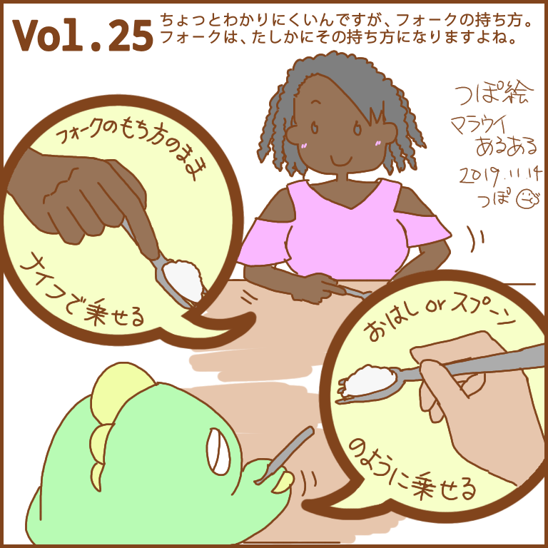</a>
    <h3>Vol.25　スプーンの持ち方</h3>
    <blockquote>
    手シリーズ。 
    日本人は箸またはスプーンの持ち方で食べる人が多いかと思うんですが、こっちの人は、ナイフとフォーク持つ感じのまま、でもフォークの「腹」にご飯とか乗せます。食べにくそうな気もする。
    でも、時々それも面倒なのか手で食べ始めます（笑）
    </blockquote></article>
    <article><a href="/images/malawi-aruaru/malawi-aruaru-026.png">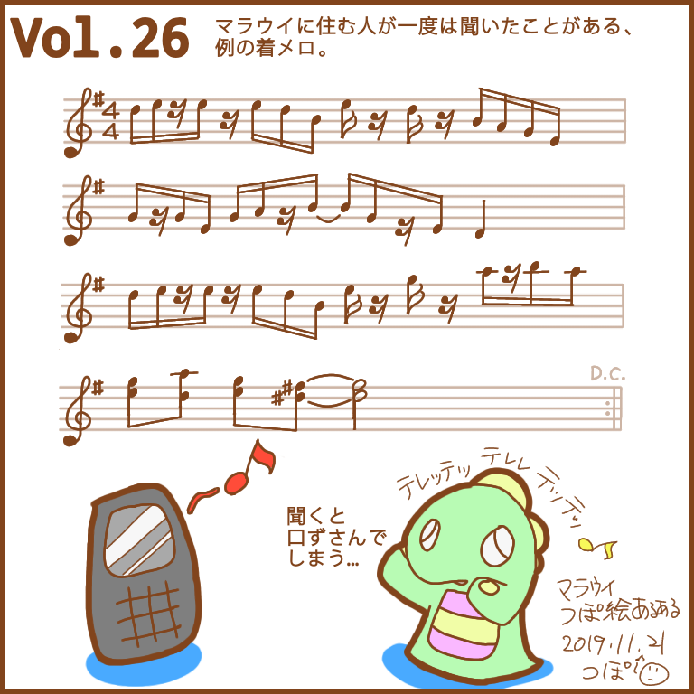</a>
    <h3>Vol.26　着信音</h3>
    <blockquote>
    段々とコアな内容になっております。音楽シリーズ。 
    いつもの5倍ぐらいの時間掛かった…
    シリーズと言いつつ楽譜はもうしんどいかもしれない。
    楽譜わかんない！という方は<a href="https://musiclab.chromeexperiments.com/Song-Maker/song/5973662383472640">こちら</a>からどうぞ。
    </blockquote></article>
    <article><a href="/images/malawi-aruaru/malawi-aruaru-027.png">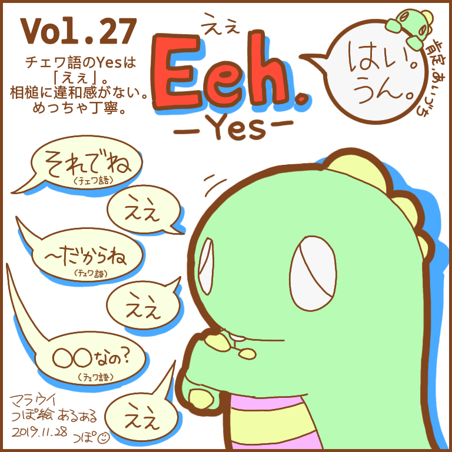</a>
    <h3>Vol.27　チェワ語「Eeh」（Yes）</h3>
    <blockquote>
    久しぶりにチェワ語。 
    今回は「Yes」。 
    この、Eehは口語で、文字として書くなら違うらしいけど、それだと「えぇ？！Anger Symbol」って日本人には詰められてるように聞こえるあれになっちゃうらしいので、あえてこのEehで。Eeeとも書く。 
    えぇ。 
    日本人には言いやすい。
    </blockquote></article>
    <article><a href="/images/malawi-aruaru/malawi-aruaru-027-2.png">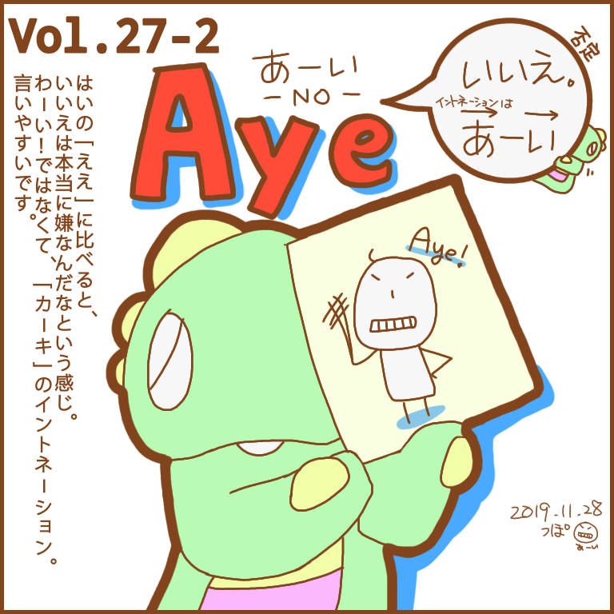</a>
    <h3>Vol.27-2　チェワ語「Aye」（No）</h3>
    <blockquote>
    今週は豪華二本立て。
    （本当は来週にしようかなと思ったけど、まあ内容が内容だし、と） 
    「No」です。 
    なにが言いたかったって、「えぇ」に比べてこの「アーイ」の拒絶感たるや。本当に言った後こんな表情になる。 
    違うわ！！という感情を込めて。 
    あーい😬
    </blockquote></article>
    <article><a href="/images/malawi-aruaru/malawi-aruaru-028.png">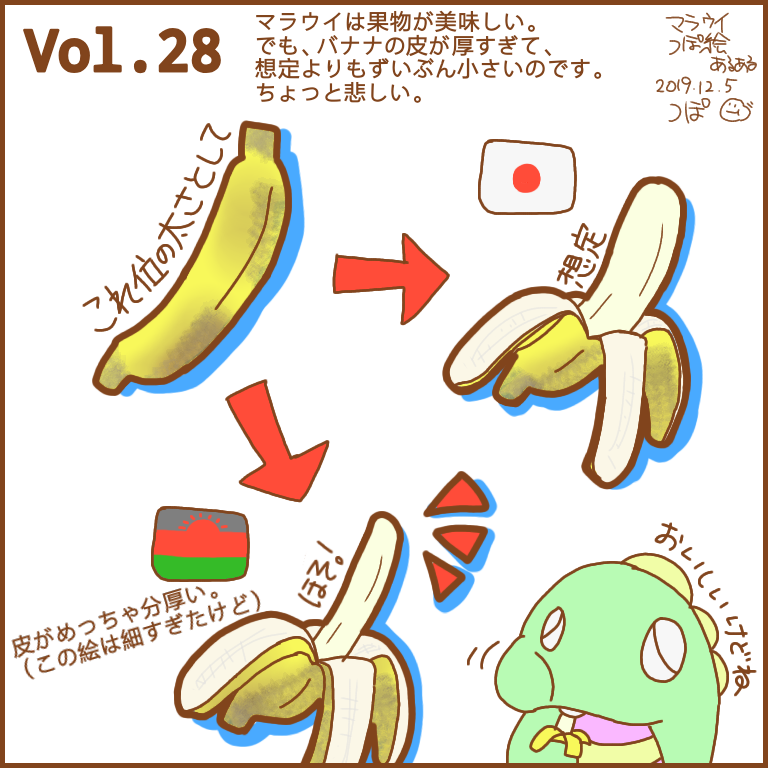</a>
    <h3>Vol.28　バナナ</h3>
    <blockquote>
    バナナ売りのお姉さんを見て、思い出しました。
    こっちのバナナ、ほせぇわ、と。 
    ローカル（自然のまま作られたもの）は全部日本じゃ「クズ野菜、くず果物」ぐらいの形、見た目。でも、甘くて美味しい。
    想定より食べた気にならないけど。
    </blockquote></article>
    <article><a href="/images/malawi-aruaru/malawi-aruaru-029.png">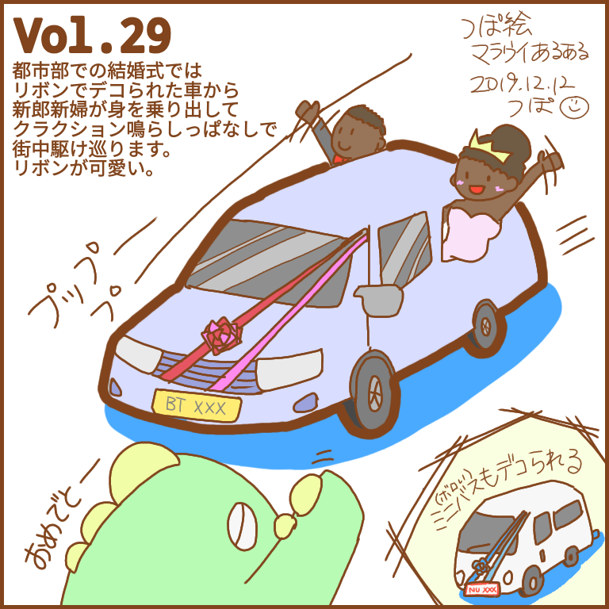</a>
    <h3>Vol.29　結婚式の車</h3>
    <blockquote>
    結婚式はでたことがないんですけど、結婚した新郎新婦が乗った車はよく見ます。
    新郎新婦のだけじゃなくて、知人や友人の車もリボン付き。クラクションならしまくり。
    にぎやかやなーって思ったら、だいたい結婚式のやつか、政党のデモです。
    </blockquote></article>
    <article><a href="/images/malawi-aruaru/malawi-aruaru-030.png">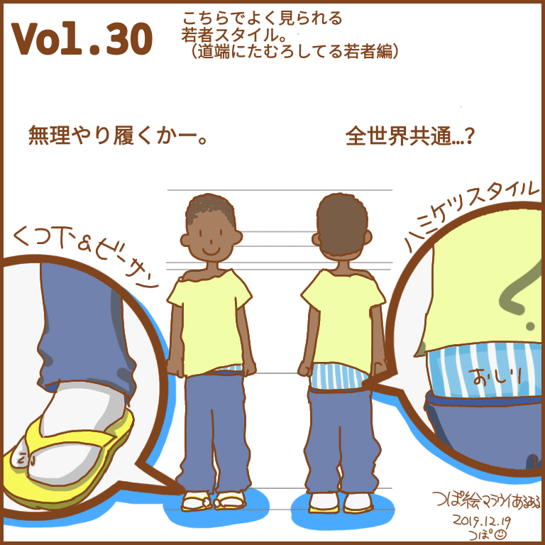</a>
    <h3>Vol.30　男性ファッション</h3>
    <blockquote>
    最近ミニバスからよく見る若者の姿。 
    靴下&ビーサン。足袋とか五本指ソックスとかはない。靴はビーサン。だから無理矢理になる。……靴下いるか？それ。 
    あ、あと、お尻が完全にズボンから出てますけど、それ、私がひっぱりあげて差し上げましょうか？
    </blockquote></article>

---

### Related Post
- 
- 
- 　&lt;&lt;&lt; 次
- 
- 
