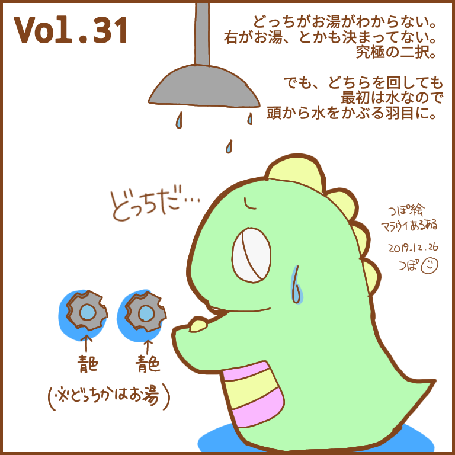
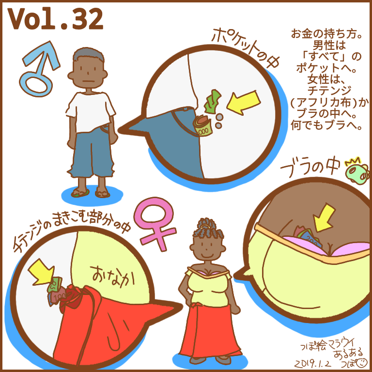
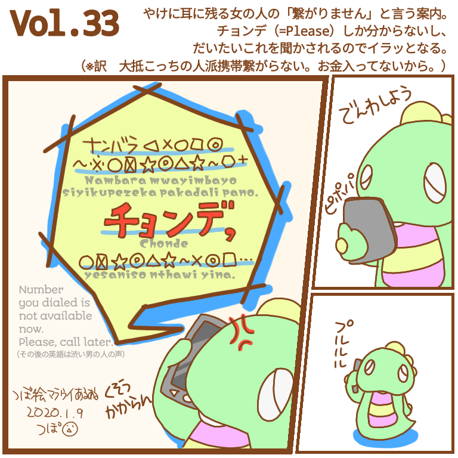
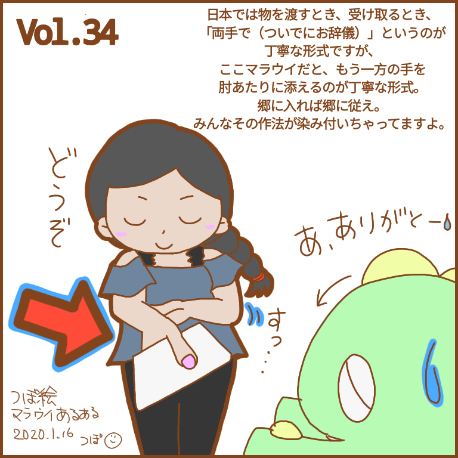
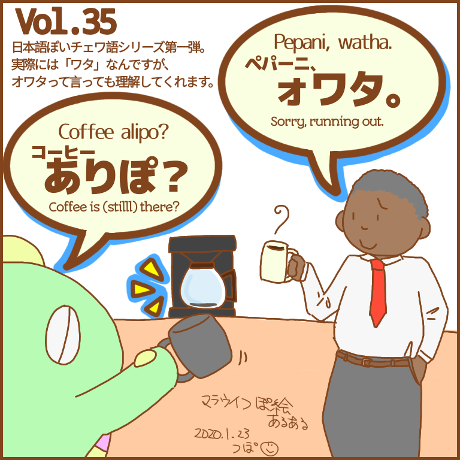
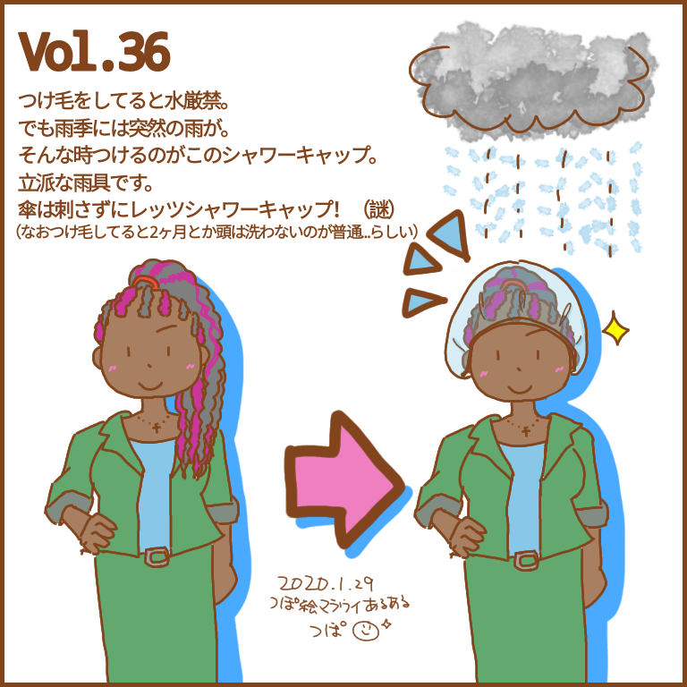
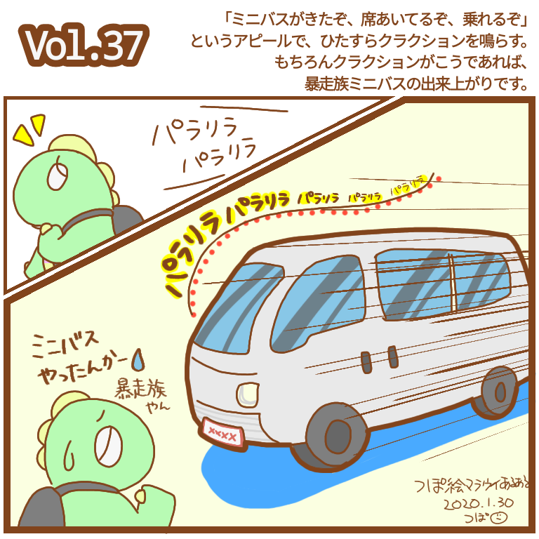
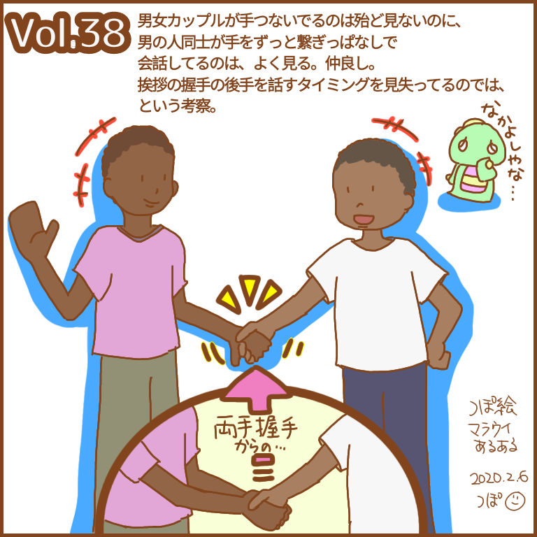
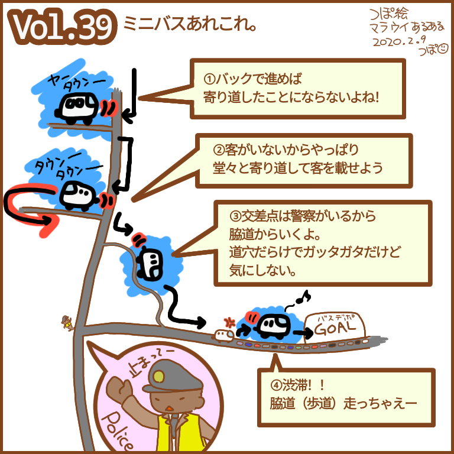
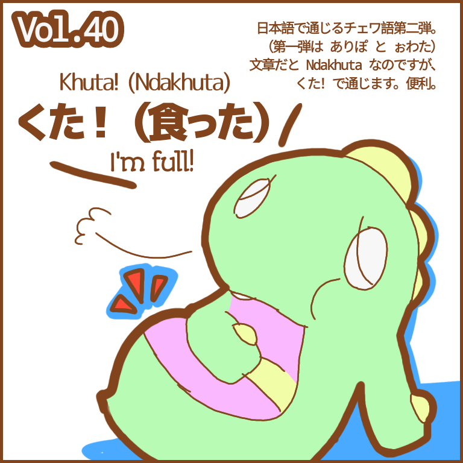

---
title: マラウイあるある Vol.31-40
date: 2020-03-09 23:15:00
description: アフリカのマラウイ (malawi) 生活をイラストで綴る「つぽ絵マラウイあるある」Vol.31〜40。シャワーのお湯事情、お金のしまい方、チェワ語「くた」、クラクション、ミニバス、握手文化など。
category:
#     - LINEスタンプ
#     - さいとうさん
#     - マラウイ(Malawi)
tags:
    - マラウイ(Malawi)
    - アフリカ(Africa)
    - お絵かき
    - マラウイあるある
cover: "/images/malawi-aruaru/malawi-aruaru-031.png"
cover_index: "/images/malawi-aruaru/malawi-aruaru-031.png"
# cover_detail: "/images/malawi-aruaru/malawi-aruaru-001.png"
sitemap: true
---

毎週木曜日に更新していた「つぽ絵マラウイあるある」シリーズ。その 4。

    <article>
    <h3>Vol.31　シャワー</h3>
    <blockquote>
    シャワーのお話。 
    シャワーがあるおうちはもちろん、お金を出して泊まるホテルでさえ両方青色の確率が高い。
    どちらがお湯なのか…出してみないとわからない。そして出してもわからない（給湯器と待ってたりするから）
    どっちも赤、はあんまりみたこと無い。
    </blockquote></article>
    <article>
    <h3>Vol.32　お金のしまい方</h3>
    <blockquote>
    お正月、お年玉の季節なので、お金にまつわる話を。 
    みなさんのお金をどこにしまってるか。
    財布はみんな持ってるようで持ってない。そもそもかばんを持つことがステータス。
    じゃあ、お金はどこに…？ 
    こたえは、イラストで。
    </blockquote></article>
    <article>
    <h3>Vol.33　電話に出れません</h3>
    <blockquote>
    体調はよろしくないですが、その分暇なので今週もあります。今回は漫画風コマ割り。
    チョンデ、しか聞こえないのは私がチェワ語を勉強してないからだけど、やっぱりチョンデ、しか、聞こえない。 
そしてこれ聞こえると「あっあー¯\_(ツ)_/¯」ってなる。あっあー。
    </blockquote></article>
    <article>
    <h3>Vol.34　渡し方</h3>
    <blockquote>
    ありがとうを言うときは膝をちょっと曲げる。
    物を渡すときはもう片方の手を肘あたりに添える。 
    私はついついなんでもお辞儀しちゃうんですが、みんなマラウイ色にそまってきているようです。 
    なお、この女の子にモデルはいません。いませんってば。
    </blockquote></article>
    <article>
    <h3>Vol.35　チェワ語「ありぽ」「おわた」</h3>
    <blockquote>
    チェワ語のターンです。 
    「ある」？が「ありぽ？」（物によっていりぽ、ちりぽ色々変わるけどコーヒーはありぽ） 
    ＼(^o^)／ｫﾜﾀは「(物に対して)使い終わった」。 
    「(人に対して)作業が終わった」はKumalizaの動詞を使います。Ndamaliza! (I've finished!)
    </blockquote></article>
    <article>
    <h3>Vol.36　シャワーキャップ</h3>
    <blockquote>
    帰るまでにVol.100にいかせたいなと思ったので、毎月9がつく日にも上げることにしました。 
    最初の頃なんでみんな外でシャワーキャップしてるのか本当に謎だったけど、なるほど、と。
    こちらのつけ毛は人工毛じゃないので、つけてる間は水厳禁、らしい。やばい。
    </blockquote></article>
    <article>
    <h3>Vol.37　クラクション</h3>
    <blockquote>
    昨日投稿したところなので変な感じですが… 
    クラクションはならすもの（当たり前）
    ミニバスのクラクションはまだ乗れるよと言う合図。 
    それにしてもこのミニバス、日本でどんな用途で使われてたんだろう。パラリラパラリラ。
    </blockquote></article>
    <article>
    <h3>Vol.38　握手</h3>
    <blockquote>
    昼に画像書き出しまでしたのに投稿するのすっかり忘れてた… 
    道端で、男性が手を繋ぎっぱなしで会話してることがよくあります。
    仲良しさん。 
    挨拶の握手をしてから手を話すタイミングを見失っているのでは、と言う考察を聞いて、なるほどーと納得。それっぽい。
    </blockquote></article>
    <article>
    <h3>Vol.39　ザ・ミニバス</h3>
    <blockquote>
    9日なのであげます。
    もう10日たったか…早くない？ 
    毎日通勤で乗るミニバスは本当ネタの宝庫です。
    大体ミニバスに載ってるときにあるあるのネタが思いつくので。
    </blockquote></article>
    <article>
    <h3>Vol.40　チェワ語「くた」</h3>
    <blockquote>
    日本語で通じるチェワ語第二弾。 
    おなかいっぱい！は 「くた」。 
    ありぽ？といい おわた とといい今回の くた といい、なんか、みんな好きそうですよね。
    私は好きです。 
    はぁーくったくった。
    </blockquote></article>

---

### Related Post
- 
- 
- 
- 　&lt;&lt;&lt; 次
- 
