---
title: マラウイあるある Vol.41-50
date: 2020-03-09 23:20:00
description: アフリカのマラウイ (malawi) 生活をイラストで綴る「つぽ絵マラウイあるある」Vol.41〜50。野犬、ガソリン、まつげ、チェワ語「むぁむわ」、蚊帳、トイレ事情、50回目の国際空港など。
category:
#     - LINEスタンプ
#     - さいとうさん
#     - マラウイ(Malawi)
tags:
    - マラウイ(Malawi)
    - アフリカ(Africa)
    - お絵かき
    - マラウイあるある
cover: "/images/malawi-aruaru/malawi-aruaru-041.png"
cover_index: "/images/malawi-aruaru/malawi-aruaru-041.png"
# cover_detail: "/images/malawi-aruaru/malawi-aruaru-001.png"
sitemap: true
---

毎週木曜日に更新していた「つぽ絵マラウイあるある」シリーズ。その 5。

    <article><a href="/images/malawi-aruaru/malawi-aruaru-041.png">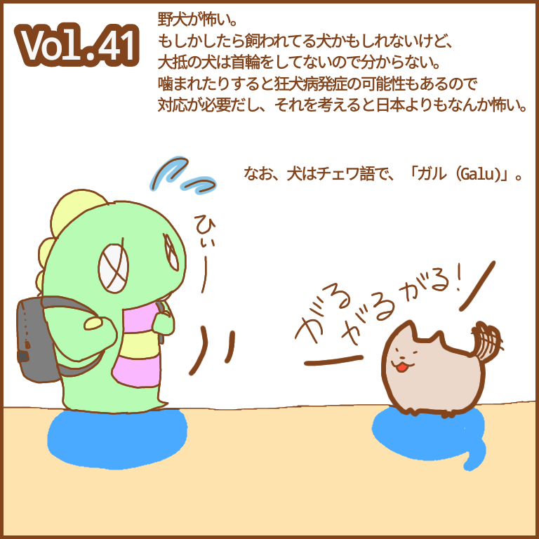</a>
    <h3>Vol.41　犬</h3>
    <blockquote>
    19日なのであげます。 
    野犬が多い。飼われてる犬かも。
    でも首輪ないからわからない。
    しかも道を塞ぐから通れない。噛まれたら病院行き（要狂犬病の暴露後注射） 
今の日本に野犬はほぼいないけど、昭和の日本がこんなイメージだったなと。とりあえず怖い。
    </blockquote></article>
    <article><a href="/images/malawi-aruaru/malawi-aruaru-042.png">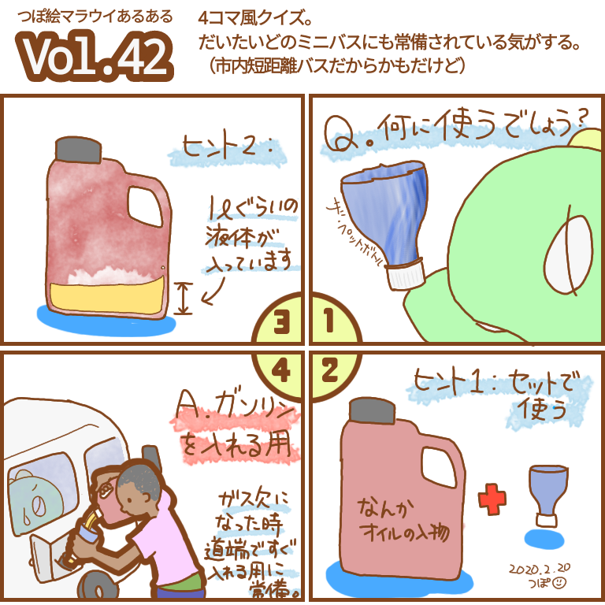</a>
    <h3>Vol.42　ガソリン</h3>
    <blockquote>
    日本ではガソリンをプラ容器に入れて保存するのはだめだった気がするんですけど。
こっちではそんなのありません。 
更にガソリン高いから（日本と同じ位の値段）だいたい300円分ぐらいだけを常にキープ。ガス欠まで乗る。切れたら道端で入れる。 
 
これが、日常。
    </blockquote></article>
    <article><a href="/images/malawi-aruaru/malawi-aruaru-043.png">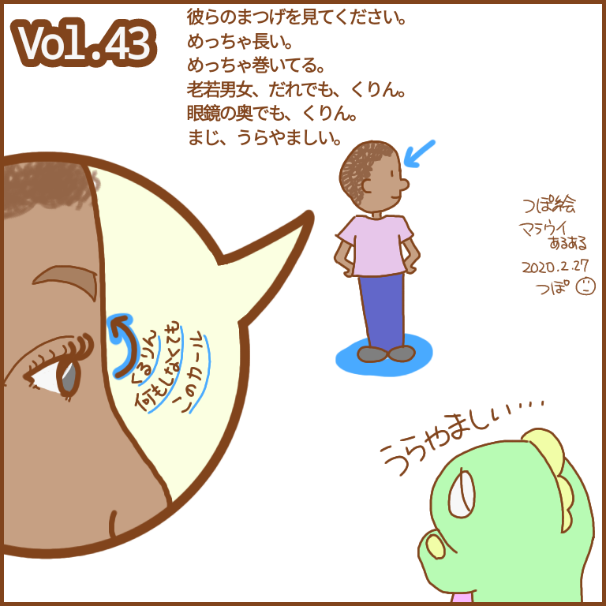</a>
    <h3>Vol.43　まつげ</h3>
    <blockquote>
    まつげが長いんですよ。彼ら。
しかもめっちゃカールしてるんですよ。
男性も女性も子供も大人も本当良いまつげ。
羨ましいですよ。 
くりん。
    </blockquote></article>
    <article><a href="/images/malawi-aruaru/malawi-aruaru-044.png">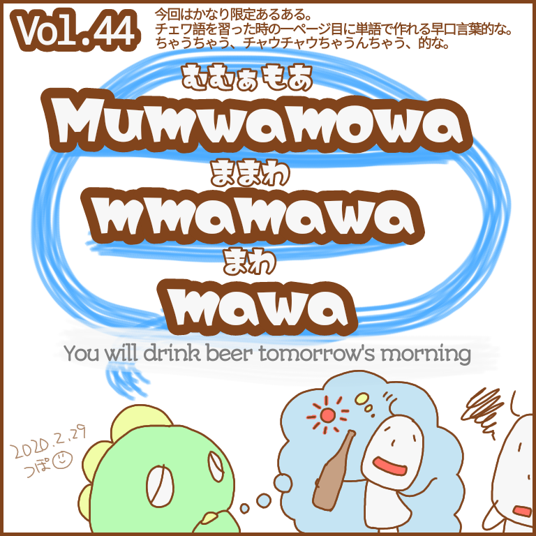</a>
    <h3>Vol.44　チェワ語「むぁむわ」</h3>
    <blockquote>
    チェワ語のターン。 
    今回はちょっと趣向を変えて。
    単語の紹介でもいいけど面白い文章を。 
    しかも多分同じチェワ語研修受けてたらみんなわかってくれそうな、狭い「あるある」。 
    Mu: you, 
    mwa: drink 
    mowa: beer 
    mmamawa: morning 
    mawa: tomorrow
    </blockquote></article>
    <article><a href="/images/malawi-aruaru/malawi-aruaru-045.png">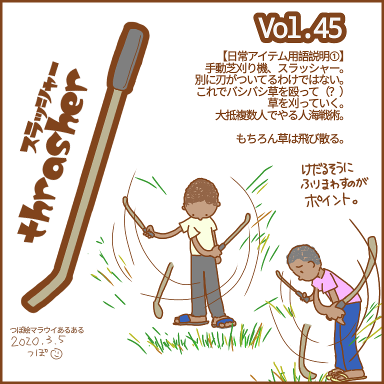</a>
    <h3>Vol.45　用語解説①「スラッシャー」</h3>
    <blockquote>
    日常アイテム用語説明①。 
    スラッシャー。芝を刈るアイテム。 
    攻撃力は半端ない。
    刃に見えるところに刃はない。ただ物理的に芝を殴って刈る。 
    疲れるだろうなあ…と思いつつ、私はこれを使って昼の警備員さんに芝刈りをやってもらってます。
    </blockquote></article>
    <article><a href="/images/malawi-aruaru/malawi-aruaru-046.png">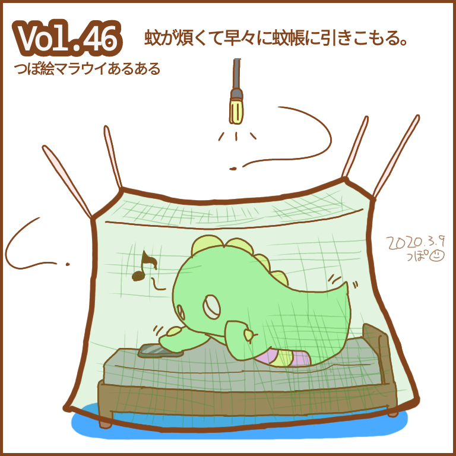</a>
    <h3>Vol. 46 蚊帳</h3>
    <blockquote>
    蚊帳の中は安全地帯。 
    煩いは、うるさい、ともわずらわしい、とも読ませる作戦。
    </blockquote></article>
    <article><a href="/images/malawi-aruaru/malawi-aruaru-046-omake1.png">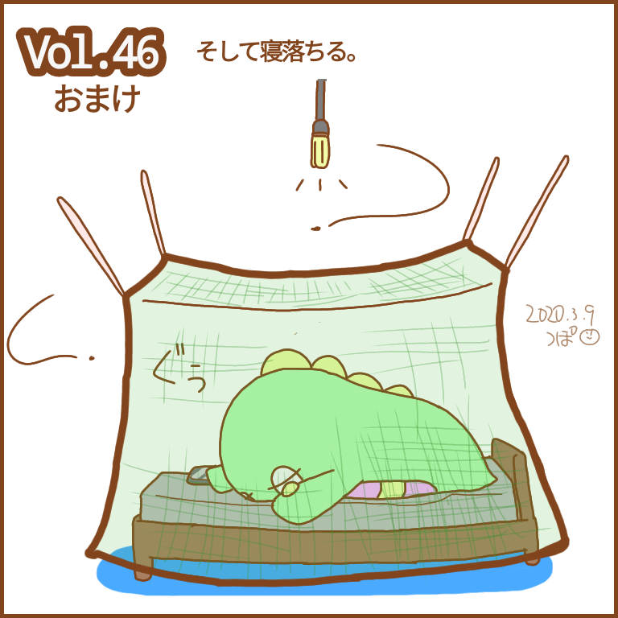</a>
    <h3>Vol.46 おまけ</h3>
    <blockquote>
    まぁ、寝落ちるよね。
    </blockquote></article>
    <article><a href="/images/malawi-aruaru/malawi-aruaru-046-omake2.png">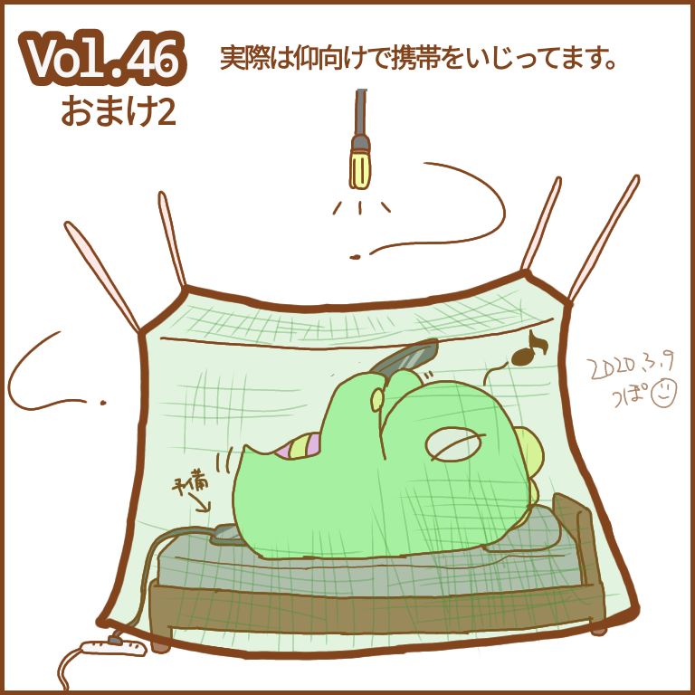</a>
    <h3>Vol.47 おまけ2</h3>
    <blockquote>
    うつ伏せよりも仰向けのほうが好きです。
    （腕力と背筋がないから自分の体を支えれない）
    </blockquote></article>
    <article><a href="/images/malawi-aruaru/malawi-aruaru-047.png">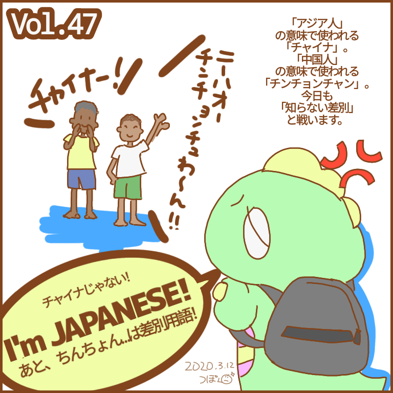</a>
    <h3>Vol. 47 チャイナ</h3>
    <blockquote>
    知らない差別なのか、知ってて差別なのかはわからない。 
    知らないなら教えてあげたらちゃんと正してくれるけど、知ってて差別の場合はどうしたらいいんでしょうか。
    </blockquote></article>
    <article><a href="/images/malawi-aruaru/malawi-aruaru-048.png">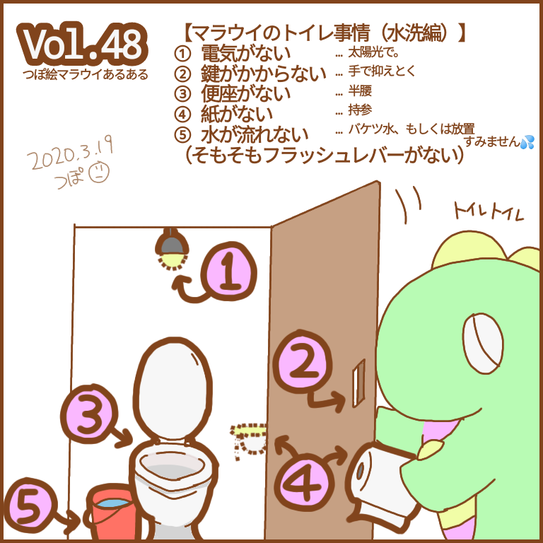</a>
    <h3>Vol. 48 トイレ事情</h3>
    <blockquote>
    一時退避でもうてんやわんやですが、木曜日でさらに9のつく日なので更新します。
    被ったから一週間更新なくて長かったよ。 
    今回はトイレのお話。
    以前ツイートしたやつのつぽ絵あるあるバージョンです。 
    これももうしばらくお預けです。
    いや帰ってくるかなー！！
    </blockquote></article>
    <article><a href="/images/malawi-aruaru/malawi-aruaru-049.png">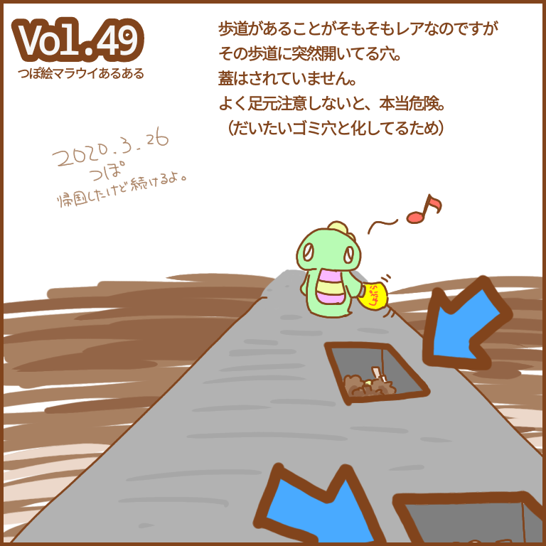</a>
    <h3>Vol.49　道路の穴</h3>
    <blockquote>
    （一時）帰国したけどまだやります！ 
    日本は木曜日じゃなくなっちゃったけどマラウイはまだ木曜日だからセーフです。 
    道路の穴のお話。都市部編、だと思います。
    そもそもこの穴は何用なのかはわからない。
    用水路…？
    </blockquote></article>
    <article><a href="/images/malawi-aruaru/malawi-aruaru-050.png">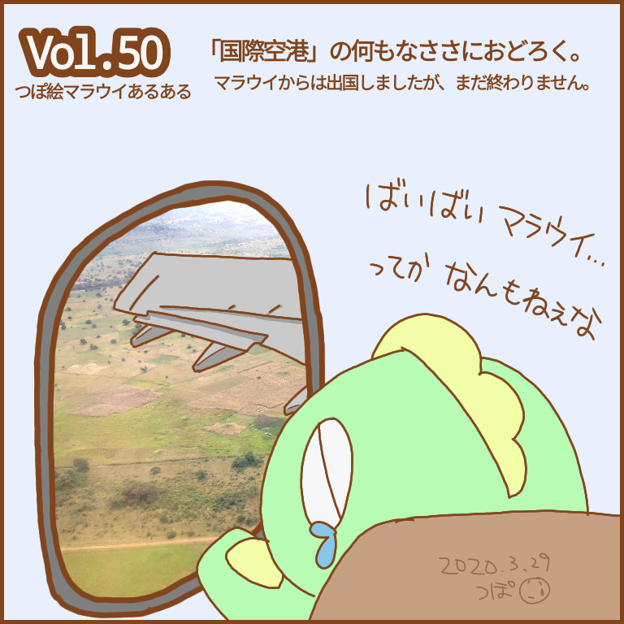</a>
    <h3>Vol.50　国際空港</h3>
    <blockquote>
    100回にいかせるために回数増やしたのに、その半分でマラウイから出国してるとは思わなかった… 
    記念すべき50回なので直近の写真を拝借。 
    来るときはそこまで思わなかったけど、出るときに強烈に思う、「これが…国際空港？！」感。
    </blockquote></article>

---

### Related Post
- 
- 
- 
- 
- 　&lt;&lt;&lt; 次
