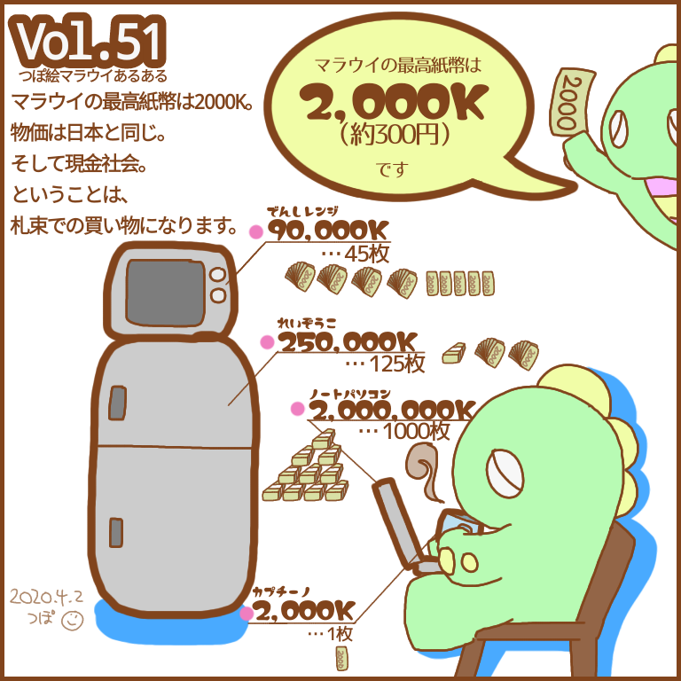
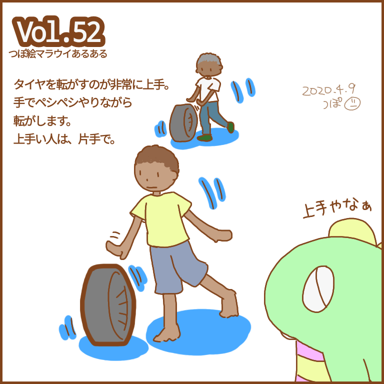
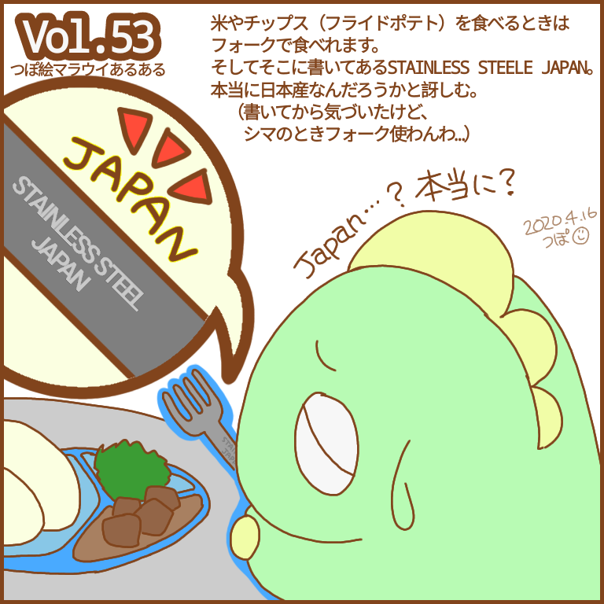
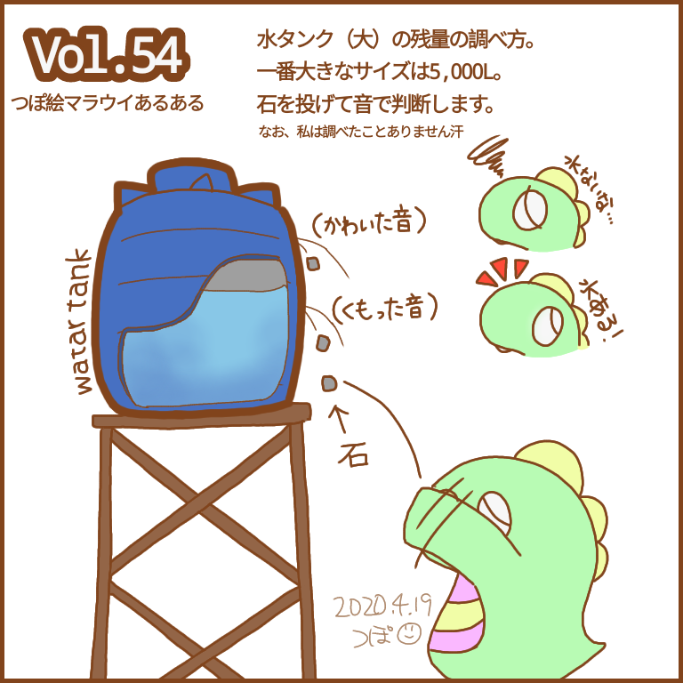
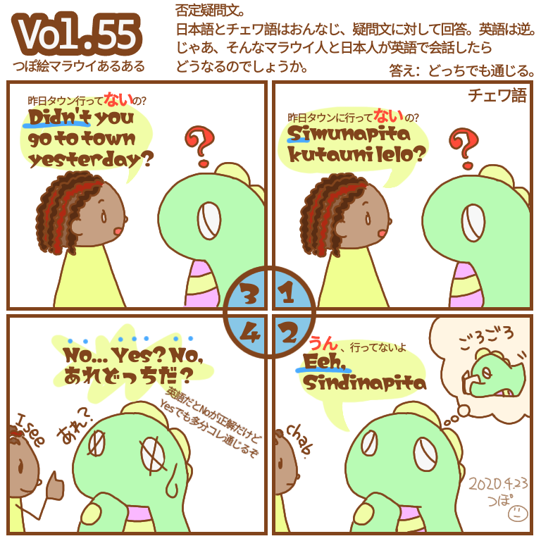
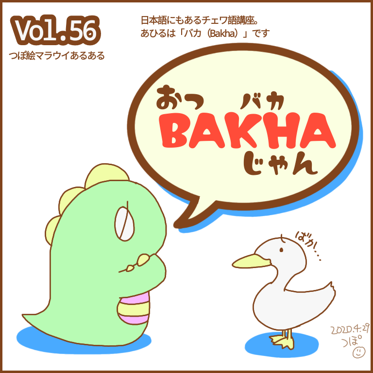
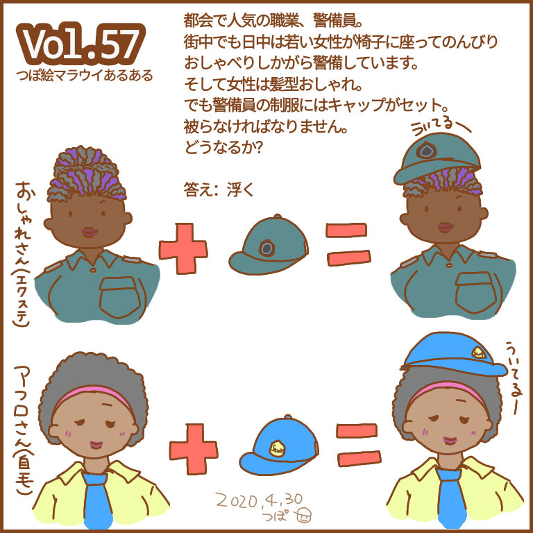
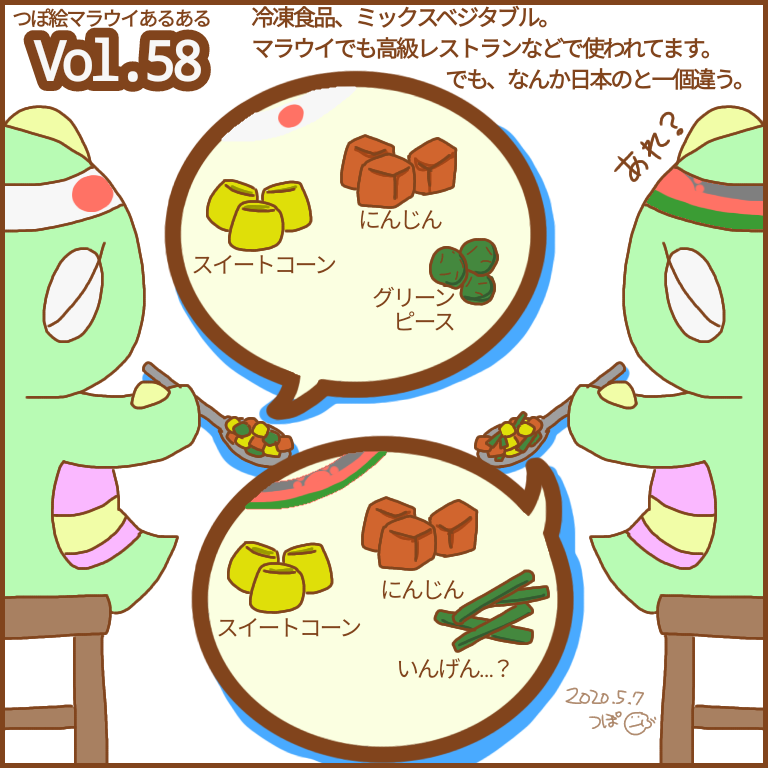
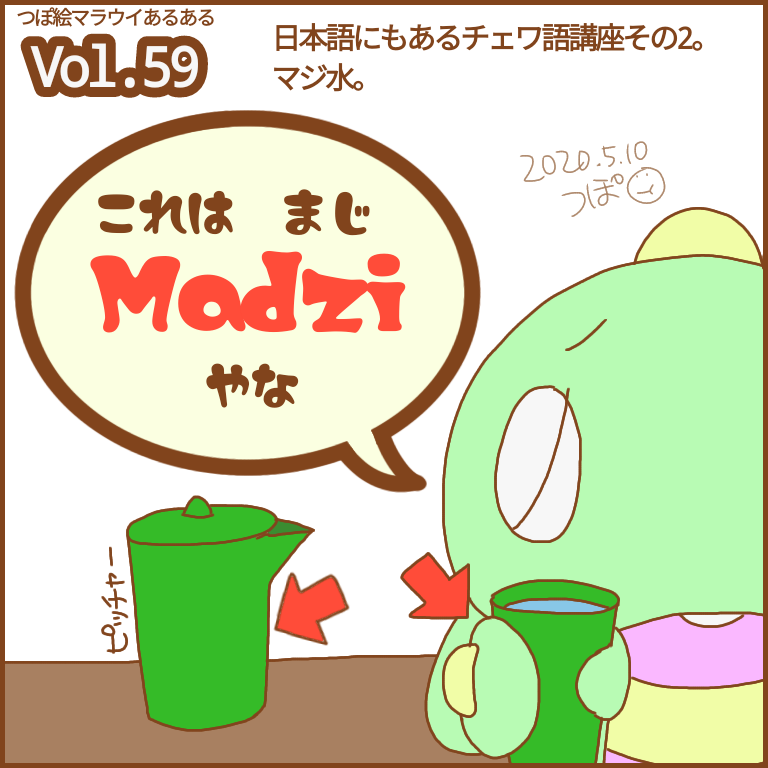
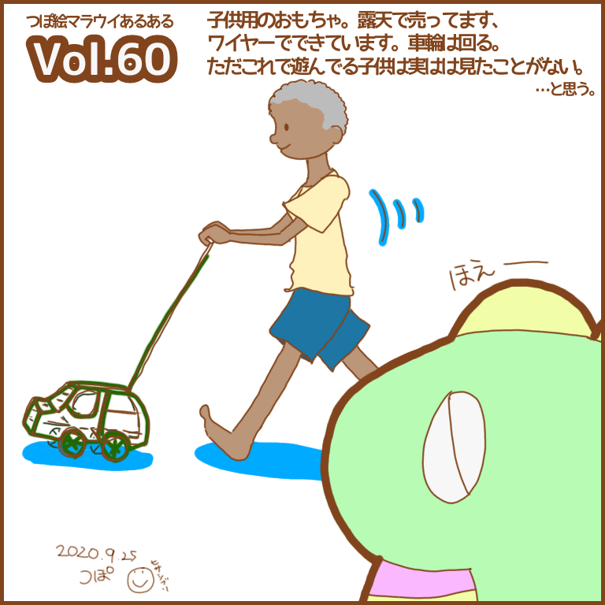

---
title: マラウイあるある Vol.51-60
date: 2020-03-09 23:25:00
description: アフリカのマラウイ (malawi) 生活をイラストで綴る「つぽ絵マラウイあるある」Vol.51〜60。マラウイクワチャ（通貨）、タイヤ転がし、断水と水タンク、チェワ語「あひる」、車のブリキのおもちゃなど。
category:
#     - LINEスタンプ
#     - さいとうさん
#     - マラウイ(Malawi)
tags:
    - マラウイ(Malawi)
    - アフリカ(Africa)
    - お絵かき
    - マラウイあるある
cover: "/images/malawi-aruaru/malawi-aruaru-051.png"
cover_index: "/images/malawi-aruaru/malawi-aruaru-051.png"
# cover_detail: "/images/malawi-aruaru/malawi-aruaru-001.png"
sitemap: true
---

毎週木曜日に更新していた「つぽ絵マラウイあるある」シリーズ。その 6。

    <article>
    <h3>Vol.51　マラウイクワチャ</h3>
    <blockquote>
    マラウイの通貨は、マラウイクワチャ。正式MWK、略してK。 
    日本の7倍ぐらいの額面になります。
    食べ物は安いが電化製品は日本と物価同じ（またはもっと高い）。 
    そして最高紙幣は2000K（約300円） 
    要するに札束での買い物です。
    額面に最初ビビる。
    </blockquote></article>
    <article>
    <h3>Vol.52 タイヤ転がし</h3>
    <blockquote>
    タイヤの手入れ（洗ったり空気入れたり）は立派なお仕事。 
    コロコロ人力で長ーい距離を転がして運びます。 
    みんなめっちゃ転がす。
    </blockquote></article>
    <article>
    <h3>Vol.53 ステンレススチール</h3>
    <blockquote>
    木曜日でした。 
    ストックからいきます。 
    カトラリー、使います。でももうぼろぼろなんです。曲がってたり… 
    で、裏見たらちゃっかりSTAINLESS STEELE JAPANとか書いてあったりするんですよ。 
    ほんまやろうか、とずっと思って毎回現地で確認してました。
    </blockquote></article>
    <article>
    <h3>Vol.54 水タンク</h3>
    <blockquote>
    かなり頻繁に断水するマラウイでは水はタンクに保存されてます。 
    大きさも色々。でも中身は見えません。 
    じゃあどうやって確認するか？ 
    そこで、石の出番。投げます。 
    っていうのを聞きました（やったこと無い）
    </blockquote></article>
    <article>
    <h3>Vol.55 否定疑問文の回答</h3>
    <blockquote>
    久しぶりのチェワ語シリーズ。 
    そもそも否定疑問文は難しいんですよ。日本語は質問に対して回答、英語は自分がどうかなので質問文ガン無視。 
    で、その回答方法にやっとで慣れたところに…チェワ語です。 
    ま、どっちで答えても通じるんですけどね。
    </blockquote></article>
    <article>
    <h3>Vol.56 あひる</h3>
    <blockquote>
    日本語にもあるチェワ語講座。（前は日本語のままでも通じるチェワ語講座もありましたが、これはちがいます） 
    まず一回目は「バカ」です。 
    あひるです。スモールファイブにもいますね！
    </blockquote></article>
    <article>
    <h3>Vol.57 キャップ</h3>
    <blockquote>
    マラウイの警備員のお話。 
    首都や地方はわからないんですが、私が住んでたBlantyreでは若い女性の警備員がけっこういました。 
    私の職場も昼間は7割女性。 
    市内でも銀行の警備員は女性。 
    しかもおしゃれな女性。ただし制服。帽子あり。 
    いつも気になっていましたよ。
    </blockquote></article>
    <article>
    <h3>Vol.58 ミックスベジタブル</h3>
    <blockquote>
    ミックスベジタブルという冷凍食品のお話。 
    いんげんは都市部でもお安く買えるお野菜。 
    なのでですかね？ 
    （でもこんな冷凍食品は南アフリカから来てると思うんだけどな…？） 
    でも、グリーンピースもあるのはあるのですよ。
    </blockquote></article>
    <article>
    <h3>Vol.59 水</h3>
    <blockquote>
    一日遅れました。 
    日本のサラリーマンに戻りつつあるので気力がなくなってきてしまっております。 
    今回も日本語にあるチェワ語編。 
    マジ水。　 
    ピッチャーとコップはプラスチック製がふつうです。
    </blockquote></article>
    <article>
    <h3>Vol.60 車のブリキのおもちゃ</h3>
    <blockquote>
    4ヶ月ぶりに。 
    かなり昔（Vol.2と3の間）に下書きしたものを清書。 
    数カ月ぶりのマラウイあるあるです。 
    この車、遊んでるのブランタイヤでも見たことないんだけど。 
    </blockquote></article>

2020 年 3 月の COVID-19 による緊急帰国のせいで、予定が大幅にずれ、vol.100 まで続きませんでした。
（ネタはあるんだけど…）

---

### Related Post
- 
- 
- 
- 
- 
